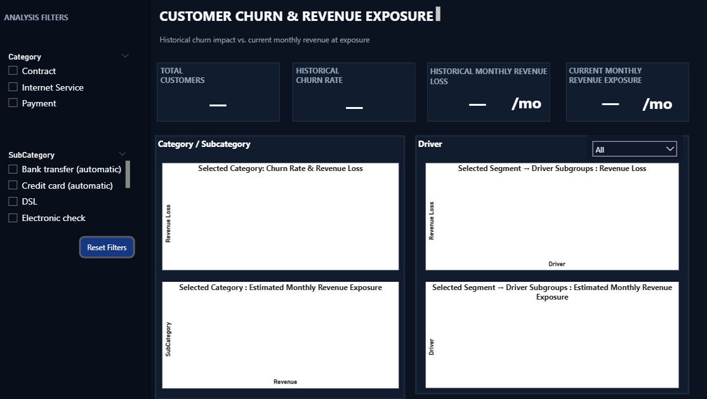
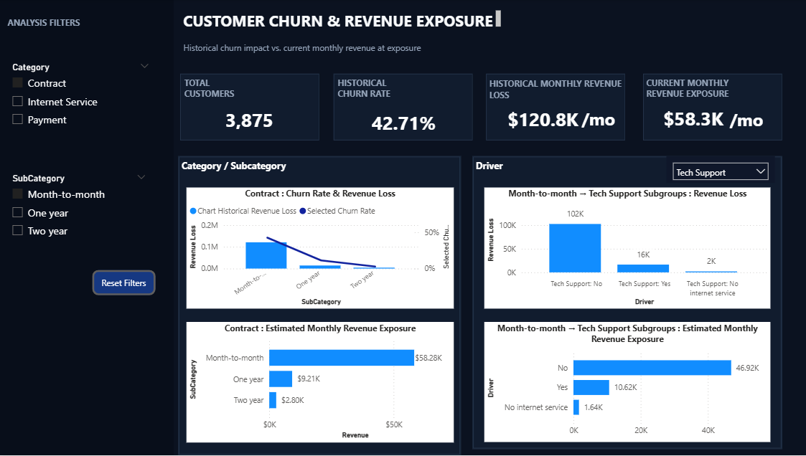
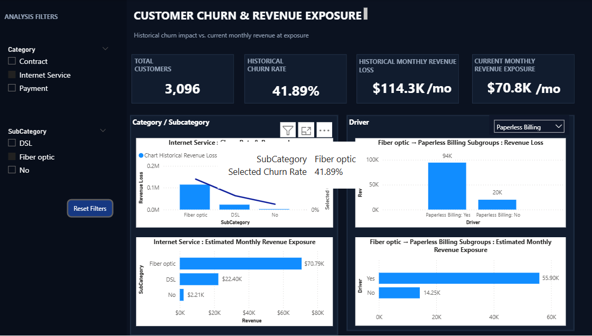
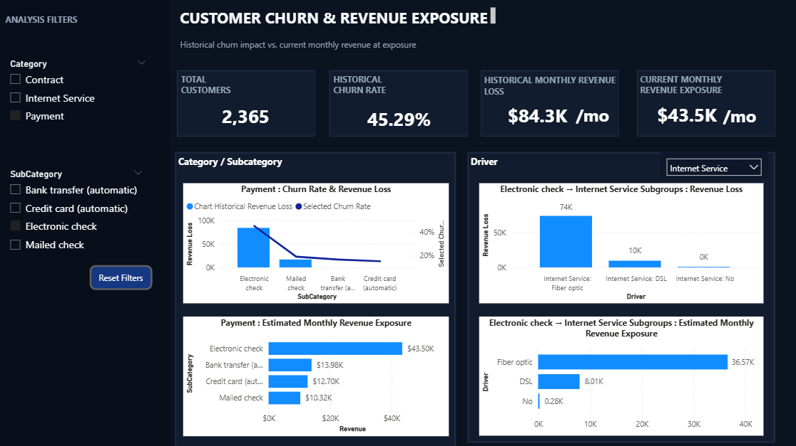

# Customer Churn & Revenue Exposure Analytics

### Dashboard Images (Power BI)

  <table>
    <tr>
      <td align="center"><b>Default</b></td>
      <td align="center"><b>Contract Analysis</b></td>
      <td align="center"><b>Internet Analysis</b></td>
      <td align="center"><b>Payment Analysis</b></td>
    </tr>
    <tr>
      <td align="center"></td>
      <td align="center"></td>
      <td align="center"></td>
      <td align="center"></td>
    </tr>
  </table>

The `.pbix` file is included in the repository for review and can be opened in **Power BI Desktop**.
 
 

## Executive Summary
Customer churn affects recurring revenue, but the overall churn rate alone does not show where retention efforts could have the greatest business impact.

Using **SQL, Python (Pandas), and Power BI**, I analyzed 7,043 customer records and found that 26.5% of customers had already churned. I then screened 17 customer attributes based on churn patterns, estimated monthly revenue exposure, group size, and actionability. This led to three focus factors: **Contract Type, Internet Service, and Payment Behaviour**.

For each factor, I selected a priority segment for deeper analysis, identified subgroups with elevated churn, and ranked the qualifying subgroups by estimated monthly revenue exposure to highlight potential retention opportunities.
  
 

**Workflow:**

  

## Business Problem:
Customer churn threatens recurring revenue, but limited retention resources make it important to identify where retention efforts could have the greatest potential business impact. The business needs to understand which customer segments have higher churn, estimate their potential monthly revenue exposure, and prioritize segments for further investigation.
 
 

## Methodology
1. **Data Preperation:** Cleaned and validated the 7,043 customer records using SQL (PostgreSQL) and Python (Pandas).

2. **Factors Screening:** Screened 17 customer attributes using churn-rate differences, estimated monthly revenue exposure, group size, and business actionability.

3. **Validation:** Used Cramér's V to assess associations between customer attributes and churn, and logistic regression permutation importance to evaluate predictive relevance. These methods supported the analysis but did not establish causation.

4. **Prioritization:** Selected three focus factors—Contract Type (Month-to-month), Internet Service (Fiber optic), and Payment Behaviour (Electronic check)—for deeper analysis.

5. **Driver analysis:** Examined one customer characteristic at a time within each priority segment. Subgroups needed at least 100 customers and a 95% confidence interval for their churn rate entirely above the corresponding priority segment's churn rate. Gender, Senior Citizen, Partner, and Dependents were excluded from actionable driver rankings. Qualifying subgroups were ranked by estimated monthly revenue exposure, with the top three reported for each priority segment.

6. **Dashboard Development:** Built an interactive Power BI dashboard to explore churn patterns and estimated monthly revenue exposure.
 

### Metric Definition

Estimated monthly revenue exposure was calculated as:

Active monthly revenue × historical churn rate of the group

This estimate uses historical churn patterns to screen potential exposure among active customers; it is not a forecast of actual future losses.
 
 

## Skills:
**SQL**: PostgreSQL, Data exploration(EDA), data cleaning, validation checks, aggregation, conditional aggregation (FILTER), GROUP BY analysis, calculated metrices

**Python**: Pandas, Matplotlib, SciPy and scikit-learn (Cramér's V, logistic regression cross-check), customer segmentation, factor screening, churn analysis, revenue exposure estimation, driver analysis, data visualization

**Power BI**: DAX measures, data modeling, interactive filtering, KPI cards, data visualization
 
 

## Results:
**Overall:** 

Of 7,043 customers, **26.5%** had churned, with **$139.1K** in monthly charges from churned customers.

After screening 17 customer attributes, **Contract Type, Internet Service, and Payment Behaviour** were selected based on their churn patterns and potential revenue impact. 

**Priority Segment Findings:** 
| Focus Factor | Priority Segment | Churn Rate | Active Customers | Est. Monthly Exposure |
|---|---|---:|---:|---:|
| Contract Type | Month-to-month | 42.71% | 2,220 | $58.3K |
| Internet Service | Fiber optic | 41.89% | 1,799 | $70.8K |
| Payment Behaviour | Electronic check | 45.29% | 1,294 | $43.5K |

**Driver Analysis Findings:** 

The following subgroups had elevated churn rates within their corresponding priority segments and were ranked by estimated monthly revenue exposure.

| Group | Subgroup inside it | Share who left | Higher than the group by | Monthly revenue at stake |
|---|---|---:|---:|---:|
| **Month-to-month** (43% left) | Without Tech Support | 50% | 1.18× | about $46.9K |
| | Without Online Security | 51% | 1.20× | about $46.5K |
| | On fiber optic internet | 55% | 1.28× | about $46.3K |
| **Fiber optic** (42% left) | Using paperless billing | 45% | 1.06× | about $55.9K |
| | Without Online Security | 49% | 1.18× | about $51.0K |
| | Without Tech Support | 49% | 1.18× | about $49.7K |
| **Electronic check** (45% left) | On fiber optic internet | 53% | 1.18× | about $36.6K |
| | Using paperless billing | 50% | 1.10× | about $34.3K |
| | Without Online Security | 53% | 1.17× | about $33.5K |

Relative churn compares a subgroup's churn rate with its corresponding priority segment's churn rate. For example, 1.20× means 20% higher than the segment average. Revenue exposure is an estimate, not a forecast, and subgroup estimates may overlap.

- **Month-to-month:** Customers without Tech Support have the highest estimated revenue exposure ($46.9K/month), while customers using fiber optic internet have the highest churn rate (55%).
- **Fiber optic:** Customers using paperless billing have the highest exposure ($55.9K/month), while customers without Online Security or Tech Support also show higher churn.
- **Electronic check:** Customers using fiber optic internet have the highest exposure ($36.6K/month), with a churn rate of 53%.
- **Common pattern:** Customers without Online Security appear among the top three subgroups in all three segments, while customers without Tech Support appear in two. Both are worth investigating for retention opportunities.

The same customer can appear in more than one row, because the groups and their subgroups overlap, so the revenue amounts are **not added together**. These are patterns associated with higher churn, not proven causes.

**Dashboard:** 

An interactive Power BI dashboard allows users to explore each focus factor and priority segment through **churn rate, estimated monthly revenue exposure, and driver-level subcategory analysis**.
 
 

## Business Recommended Actions

The following are proposed actions based on the analysis and have not been tested in practice.

| Target group | Recommended action |
|---|---|
| Month-to-month customers using fiber optic internet | Test incentives to encourage switching to longer-term contracts. |
| Month-to-month and Fiber optic customers without Tech Support | Test targeted retention offers for customers who do not use Tech Support. |
| Customers without Online Security across the three priority segments | Test free trials or bundled service offers and measure their effect on retention. |
| Electronic check customers using fiber optic internet | Investigate retention offers, as this subgroup has the highest estimated monthly revenue exposure within the Electronic check segment. |
| Fiber optic customers using paperless billing | Investigate further before targeting this group, as its churn rate is only slightly above the segment average. |

**First step:** Pilot a contract-switching offer for month-to-month customers using fiber optic internet over 2–3 months. Compare their churn with a similar group that does not receive the offer. Expand the offer only if the reduction in churn generates enough additional revenue to justify the cost.
 
 

## Limitations
- Findings are descriptive and show association, not cause.
- Estimated exposure applies each group's **historical churn rate, held constant**, to today's active customers.
- Estimated exposure is an estimate, not a forecast, because future churn may differ.
- Thresholds (100 customers, 95% interval, 30 points) are chosen screening rules, not universal standards.
- Cost and feasibility of the recommended actions were not assessed.
